# GhostLock on a Unisoc T8300

### Rooting a Redmi A7 Pro 5G (CVE-2026-43499), with a per-boot physical-KASLR derivation

A uid-2000 shell becomes uid 0, per boot, on a locked Redmi A7 Pro 5G. The
physical load address is derived from the same tracefs KASLR leak the chain
already needs. No boot image, bootloader, or partition is modified.


This is a device-specific research record, not a new CVE. On an owner-authorized
Redmi A7 Pro 5G (codename `somalia`, Unisoc T8300, Android 16, kernel 6.6.118,
locked bootloader, verified boot green), the public GhostLock chain reached a
uid-0 kernel credential patch from a uid-2000 shell on three boots. The boot
image was never touched.

Root is per-boot. There is no cross-reboot persistence.

> Status 2026-10-24: rooted and Permissive on boot `5e626925...` (P0
> `0x801f0000`), reached with the selective-fd fix. That build is under
> observation, not proven stable. Root lasts one boot.

## TL;DR

| Question | Answer |
|---|---|
| Target | Redmi A7 Pro 5G, Unisoc T8300, Android 16, kernel 6.6.118, locked bootloader, verified boot green |
| Result | GhostLock CVE-2026-43499 reached a uid-0 cred patch and per-boot Permissive from a uid-2000 shell, on three boots |
| Current | Rooted and Permissive on boot `5e626925...`, via a fix that is under observation |
| Not claimed | Persistent root, a boot-image change, disk persistence, or a stable on-device `su` |
| Evidence | [WRITEUP.md](WRITEUP.md), [TIMELINE.md](TIMELINE.md), [STATUS.md](STATUS.md), [evidence/root-runs.md](evidence/root-runs.md), [docs/](docs/) |

The one step this device forced us to add, and the thing most readers will find
interesting, is the per-boot physical load. The vendor loader places the kernel
at `0x80080000 + (TOS byte << 15)`, where the TOS byte is a per-boot
TrustZone reply that also seeds `/chosen/kaslr-seed`. The tracefs leak already
recovers that byte, so the physical load is derivable at runtime. Full story:
[WRITEUP.md](WRITEUP.md).

## Start here for researchers

1. [WRITEUP.md](WRITEUP.md): the narrative, the derivation, and both panics.
2. [TIMELINE.md](TIMELINE.md): the whole operation, dated and sanitized.
3. [STATUS.md](STATUS.md): what is true right now and what is not.
4. [docs/device/affected.md](docs/device/affected.md): build boundary.
5. [docs/device/](docs/device/): platform, boot chain, AVB, partitions.
6. [docs/exploit/](docs/exploit/): GhostLock, KASLR, P0, reliability.
7. [docs/lab/reproduce.md](docs/lab/reproduce.md): reproduction appendix.
8. [docs/methodology/disclosure.md](docs/methodology/disclosure.md): CVE/vendor status.
9. [reference/](reference/): offsets, hashes, glossary.
10. [tools/somalia/](tools/somalia/): the sanitized port material.

## What this repo is

- A record of one owned device being rooted per boot, with the evidence trail.
- The per-boot P0 formula and a script that computes it
  ([scripts/ghostlock_p0_from_slide.py](scripts/ghostlock_p0_from_slide.py)).
- Offset and constant tables for the `somalia` vendor image
  ([tools/somalia/target/](tools/somalia/target/)).
- QEMU lab notes and two incident postmortems.

## What this repo is not

- A turnkey rooting tool. There is no prebuilt `.so`, APK, or one-tap app.
- A new CVE disclosure. CVE-2026-43499 is public; see [NOTICE](NOTICE).
- A claim of persistence. Root, Permissive, P0, and any root server die with the
  boot.
- A claim of stability. The current selective-fd fix is under observation.
- A source for firmware, vendor blobs, keys, or device identifiers.

## Attack path

```mermaid
flowchart LR
  A[uid 2000 shell] --> B["tracefs KASLR leak (trace_marker -> trace_pipe_raw)"]
  B --> C["derive P0 = 0x80080000 + (TOS byte << 15)"]
  C --> D["pselect6 fd_set stack UAF"]
  D --> E["forged rt_mutex_waiter on the freed stack"]
  E --> F["PI rb-tree arbitrary write"]
  F --> G["forge ashmem misc_fops (genuine kernel text, passes KCFI)"]
  G --> H["pipe physical read/write"]
  H --> I["cred patch: uid 2000 -> 0"]
  I --> J["selinux_state.enforcing = 0"]
```



## Sample user journeys

Both are per-boot. The current build is under observation. A reboot restores
Enforcing, changes P0, and drops every root server.

### Host over ADB

The boot must already be rooted and the server listening.

```sh
adb forward tcp:12345 localabstract:ghostlock-root
./scripts/root_exec.py --serial <serial> 'id; getenforce'
```

```
uid=0(root) gid=0(root) groups=0(root) context=u:r:kernel:s0
Permissive
```

### On-device through Termux

As shell (uid 2000), leak KASLR, derive P0, root, and start the server:

```sh
/data/local/tmp/root.sh
```

Then a private `su` over the Termux socket. This path is under observation.

```sh
gl-root
su -c id
```

Do not reuse a P0 from a previous boot. Do not reboot to test the wireless
path. Termux, `gl-root`, and `su` may still be unstable until observation of
the fixed build completes.

## What root means here

| Capability | Status |
|---|---|
| uid-0 kernel cred patch (`uid 2000 -> 0`) | demonstrated on three boots |
| Full capability set | demonstrated |
| SELinux Permissive for the boot | demonstrated, in memory only |
| Root socket server as uid 0 (`u:r:kernel:s0`) | demonstrated, per-boot |
| On-device Termux wireless bootstrap | demonstrated, per-boot |
| Private `su`/`sudo` over a private socket | demonstrated, under observation |
| Persistent `su` or a boot-image change | not done |
| Cross-reboot persistence | none, by design of the locked/AVB device |

## Repo tree

```
.
├── README.md, WRITEUP.md, TIMELINE.md, STATUS.md
├── LICENSE, NOTICE, SECURITY.md, CITATION.cff
├── docs/
│   ├── device/      platform, boot chain, AVB, partitions
│   ├── exploit/     GhostLock, KASLR leak, P0 derivation
│   ├── lab/         QEMU parity and reproduction
│   ├── incidents/   the debugfs and binder panics
│   └── methodology/ evidence tags, safety, disclosure
├── reference/       offsets, hashes, glossary
├── evidence/        sanitized excerpts and run manifest
├── scripts/         P0 script and root channel helpers
├── tools/somalia/   target, patch, termux wrappers, lab notes
├── CHANGELOG.md     public release notes
└── PUBLISHING.md    canonical-source checklist
```

## Release

`v1.0` is the first public research release. See [CHANGELOG.md](CHANGELOG.md)
and [PUBLISHING.md](PUBLISHING.md).

## License and credit

This repository is Apache-2.0. The exploit and technique belong to NebuSec
("IonStack Part II: GhostLock"). Porting references: `JingMatrix/pixel-ksu-root`
and `JoinChang/ghostlock-oneplus`. Heap side channel: KernelSnitch (TU Graz).
This repo does not claim discovery of CVE-2026-43499. Details in [NOTICE](NOTICE).

## Safety

Read [SECURITY.md](SECURITY.md) before using any of this. Do not run it on a
device you do not own or have written authorization to test.
